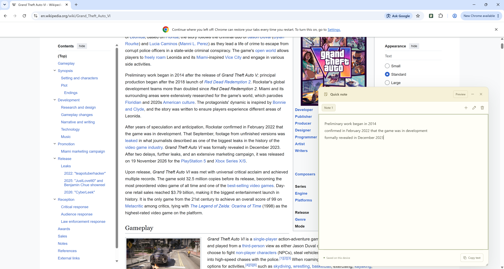
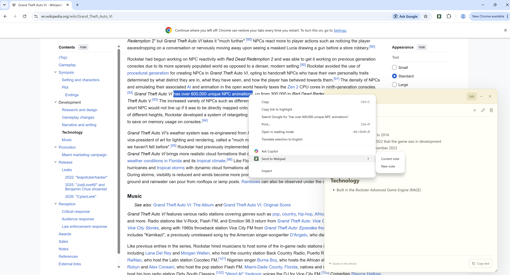
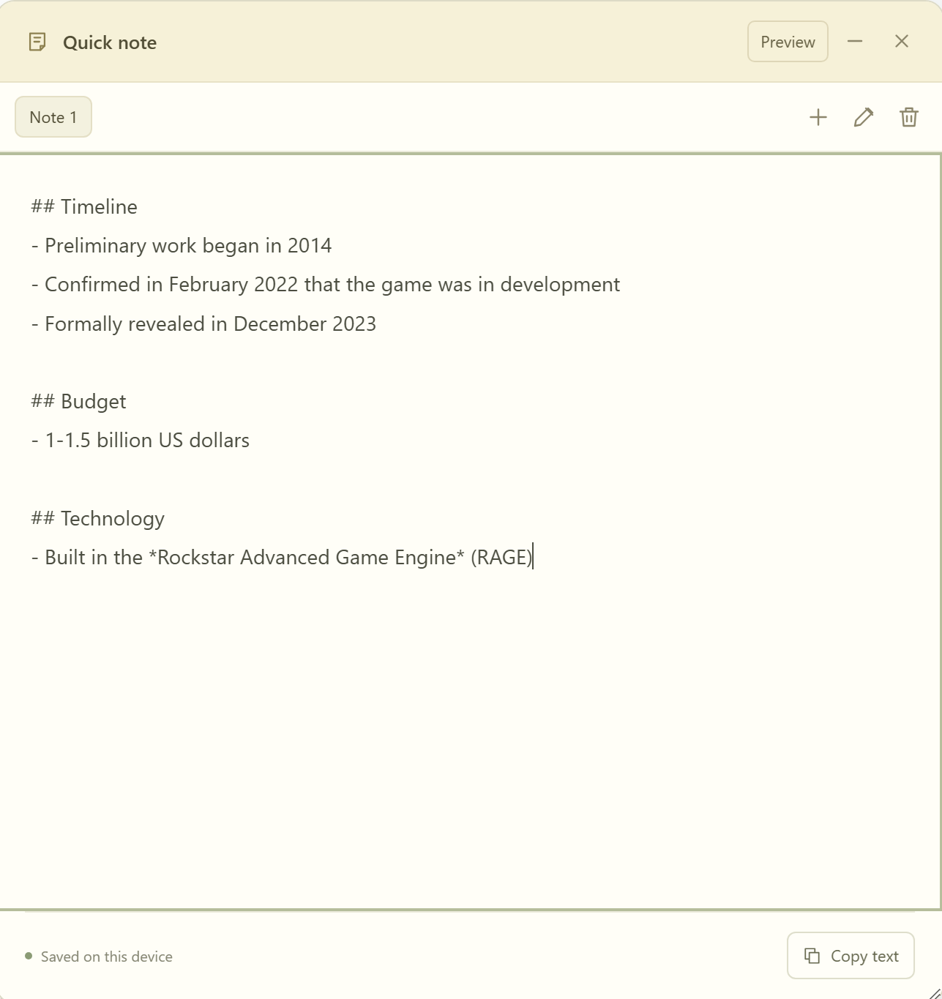
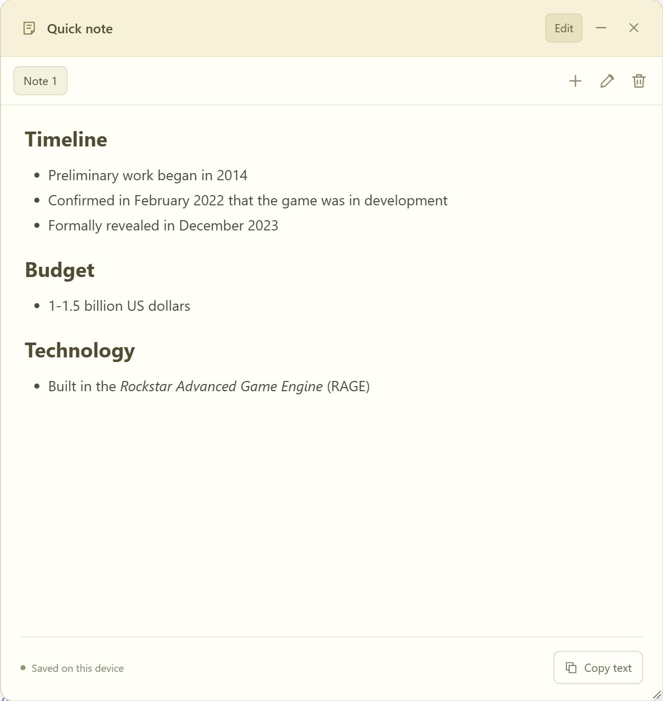

# Webpad

**A little space for your thoughts, on whatever webpage you're using.**

Webpad is a lightweight Chrome extension that puts a floating notepad beside your work. Draft a reply, collect a useful passage, or keep something handy to copy later without switching to another app.

No account, server, or build step required.

## Features

- **Floating notepad:** drag the header to move it and resize it from the bottom-right corner. Position and size are remembered.
- **Multiple notes:** create separate note tabs, rename them, and delete them with confirmation.
- **Markdown preview:** switch between editable Markdown and a formatted preview with headings, emphasis, lists, links, quotes, code, strikethrough, and tables.
- **Save selected text:** select text on a website, right-click **Send to Webpad**, and append it to the **Current note** or create a **New note**.
- **Automatic local saving:** saved notes are available across websites, browser tabs, and browser restarts in the same Chrome profile.
- **One-click copying:** copy the current note's original text, including Markdown syntax.
- **Stay out of the way:** minimize to a small launcher or close the notepad and reopen it from the toolbar.
- **Visible save status:** unsaved notes are marked with `*`, with retry and draft-recovery behavior when something goes wrong.

## Screenshots

See Webpad in action: jot down a quick thought beside a webpage, capture selected text, and turn Markdown into a readable preview.

### Take notes without leaving the page

Keep a floating note alongside the website you're reading. The note tabs, editing controls, save status, and **Copy text** button stay together in one compact workspace.



### Send selected text to your notes

Highlight a passage, right-click, and open **Send to Webpad**. Choose **Current note** to append the selection to your existing note or **New note** to keep it separately.



### Write Markdown, then preview it

Use headings, lists, and emphasis while drafting. Click **Preview** to see the formatted note, then **Edit** to return to the source. **Copy text** keeps the original Markdown in either mode.

| Markdown editor | Formatted preview |
| --- | --- |
|  |  |

## Install

Requires **desktop Google Chrome 120 or later**.

1. Download this repository using **Code > Download ZIP** and extract it, or clone it:

   ```powershell
   git clone https://github.com/haikubits/webpad-public.git
   ```

2. Open `chrome://extensions` in Chrome.
3. Turn on **Developer mode**.
4. Click **Load unpacked** and select the **`src` folder inside this repository**. This is the folder containing `manifest.json`; do not select the repository root.
5. Open Chrome's **Extensions** menu and pin **Webpad - Floating Notepad**.
6. Visit a regular website and click the **Quick note** launcher or Webpad's toolbar icon.

For webpages that were already open when you installed Webpad, click the toolbar icon or refresh the page.

Keep the extracted extension folder in a permanent location: Chrome loads the unpacked extension from that folder. Node.js, npm, and an internet connection are not needed to run it after installation.

### Updating an unpacked installation

Update the files in the same installation folder, open `chrome://extensions`, and click Webpad's **Reload** button. Refresh open webpages to load the updated interface. Review any new permission request Chrome presents.

**Do not remove and reinstall Webpad just to update it.** Removing the extension removes its saved data. Copy important notes somewhere safe before changing installations.

## Using Webpad

### Open, move, and put it away

| Action | How |
| --- | --- |
| Open the notepad | Click **Quick note** on the page or Webpad's pinned toolbar icon. |
| Move it | Drag the notepad's header. |
| Resize it | Drag its bottom-right corner. |
| Minimize it | Click the minus button or press **Escape** while focused inside the notepad. The small launcher remains. |
| Close it | Click the header's **X**. Both the notepad and launcher disappear from that page. |
| Reopen after closing | Click Webpad's toolbar icon. |

Minimizing or closing the notepad does not delete your notes.

### Manage note tabs

- Click **+** to create a blank note, then start typing.
- Click a note tab to switch to it.
- Click the **pencil** to rename the selected note. Names can contain up to 80 characters.
- Click the **trash** button to delete the selected note, then confirm or cancel. Deleting the last note leaves a new blank note.
- When a note tab has keyboard focus, use **Left/Right Arrow**, **Home**, or **End** to switch notes.

Notes belong to the extension, not to individual websites. Each webpage can keep a different note selected, while changes to a note's text or name appear in other open webpages. Newly opened pages use the last selected note.

Edits to different notes save independently. If you edit the **same note** in multiple webpages at once, the last saved edit wins.

When upgrading an existing single-note installation, your previous note is automatically preserved as **Note 1**.

### Capture selected webpage text

1. Highlight text on a webpage.
2. Right-click the selection.
3. Open **Send to Webpad** and choose **Current note** or **New note**.

**Current note** appends the text to the note selected on that webpage, including any unsaved draft. **New note** saves it as a separate note without replacing your existing notes or drafts. Both actions open the notepad in **Edit** mode, even if it was closed.

The submenu appears for text selections on webpages, not in every Chrome menu. If Chrome blocks the floating interface after the selection has been saved, the toolbar shows `!`; hover over it for a message confirming the save. Open Webpad on a supported website to view your notes.

### Preview Markdown

Write Markdown in the editor, click **Preview** to render it, and click **Edit** to return to the unchanged source.

For example:

````markdown
# Meeting notes

- **Next step:** send the draft
- Review the [reference](https://example.com)

> A thought to come back to.

```text
A snippet to copy later.
```
````

Preview follows the selected note and updates when that note changes in another webpage.

Raw HTML is displayed as text, not executed. Images show their alt text without loading external images. Only HTTP, HTTPS, and email links are clickable; links open in a new tab without sending the originating page as a referrer.

### Copy and save

**Copy text** copies the entire selected note's original text in either mode, including any Markdown syntax. It does not copy the formatted preview as rich text.

If clipboard access fails, Webpad switches to **Edit**, selects the text, and shows **Copy manually**. Press **Ctrl+C** on Windows/Linux or **Command+C** on macOS.

Notes save automatically. Wait for **Saved on this device** before leaving the page.

- A tab marked with `*` contains an unsaved change.
- If saving fails, use **Retry** or copy the text before refreshing or closing the browser tab.
- Unsaved drafts survive switching note tabs within the current webpage, but they are not a durable backup and can be lost when that webpage closes or reloads.
- If another webpage deletes a note containing your unsaved draft, Webpad keeps that draft available locally. **Retry** explicitly restores it as a shared note.

There is no fixed note-count limit, but Chrome's local extension storage quota still applies.

## Privacy and permissions

Read the full [Webpad Privacy Policy](PRIVACY.md) for data handling, retention, deletion, and contact information.

Notes and layout preferences are stored using **`chrome.storage.local`** in your Chrome profile, not in the website's storage. Webpad does not provide cloud sync or share notes between different devices or Chrome profiles.

There are no accounts, analytics, remote fonts, or network services. The Markdown parser is bundled with the extension; previews do not fetch external content. Following a link in a note opens the destination normally.

Webpad does not scan webpage content. The context-menu action only saves the selected text Chrome supplies when you invoke it.

| Permission | Purpose |
| --- | --- |
| Access to all sites (`<all_urls>`) | Display the floating interface across webpages. |
| `storage` | Save notes and layout preferences locally. |
| `scripting` | Open Webpad on demand, including on pages opened before installation. |
| `clipboardWrite` | Copy note text to the clipboard. |
| `contextMenus` | Add **Send to Webpad** with **Current note** and **New note** options to the selection menu. |

The interface uses a closed shadow root to reduce website-style conflicts. It remains an interface embedded in a webpage, not a secure vault for secrets on untrusted sites.

**Removing Webpad removes its saved data.** To keep a backup, use **Copy text** on each note and save the text elsewhere. Downloading or distributing the extension files does not include your saved notes.

## Supported pages and troubleshooting

Webpad works on regular **HTTP and HTTPS webpages**. Chrome blocks extensions on protected pages such as `chrome://` pages, the Chrome Web Store, other extensions' pages, and its built-in PDF viewer.

For local `file://` webpages, enable **Allow access to file URLs** in Webpad's details at `chrome://extensions`. Incognito access is off by default; Chrome lets you enable it in the same details page.

| Problem | What to do |
| --- | --- |
| Chrome cannot find the manifest | Select the repository's **`src` folder**, not its root or the ZIP file. |
| No notepad or launcher | Visit a supported website and click the toolbar icon. Refresh the page if Webpad was just installed or updated. |
| Toolbar shows `!` | Hover over it for the specific error. If the page is protected, open Webpad on a regular website. |
| Selection action is missing | Select webpage text first. After updating, reload the extension and refresh the page. |
| Selection was saved but the pad did not open | Read the toolbar tooltip, then open Webpad on a supported website. |
| Copying fails | Use the selected-text manual-copy fallback. |
| A note will not save | Keep the page open, copy the draft somewhere safe, then use **Retry**. Storage limits may require freeing space by deleting notes you no longer need. |

## Repository layout

```text
README.md
PRIVACY.md               Public privacy policy
screenshots\             Usage screenshots displayed in this README
src\
    manifest.json        Extension configuration and permissions
    background.js        Storage operations, toolbar, and context menu
    content.js           Floating notepad interface
    markdown.js          Markdown-to-DOM rendering
    icons\               Extension icons
    vendor\              Bundled Markdown parser and its license
```

The `src` folder is ready to load as an unpacked extension. If packaging it for distribution, ZIP the **contents of `src`** so `manifest.json` is at the ZIP root. Include the `icons` and `vendor` folders, including the bundled third-party license.
